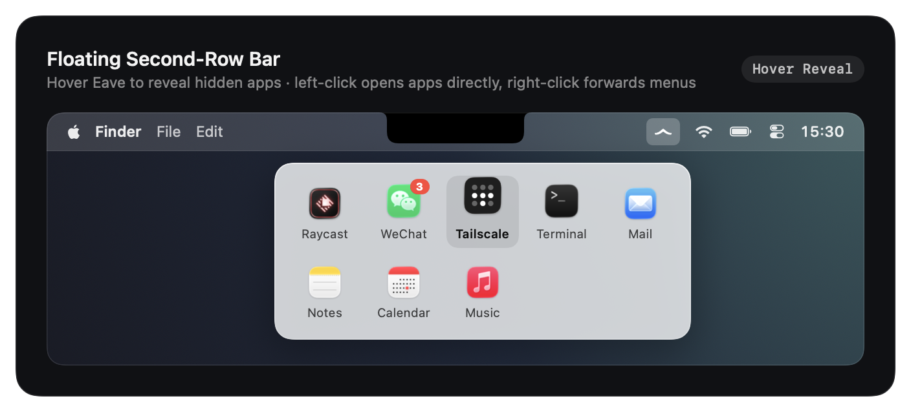
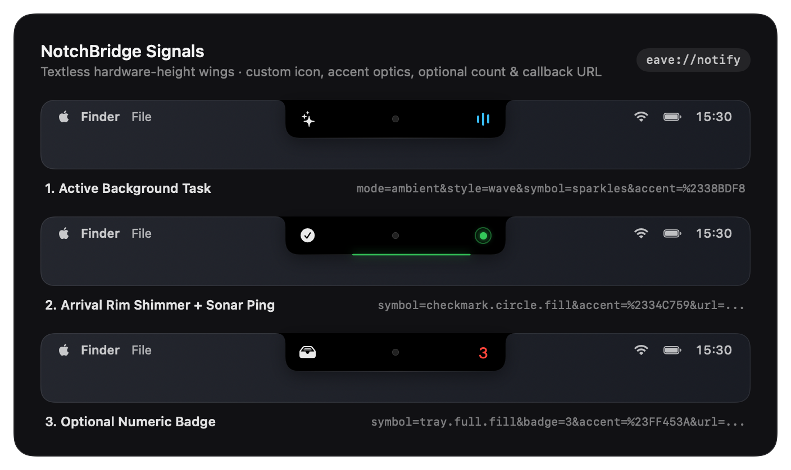
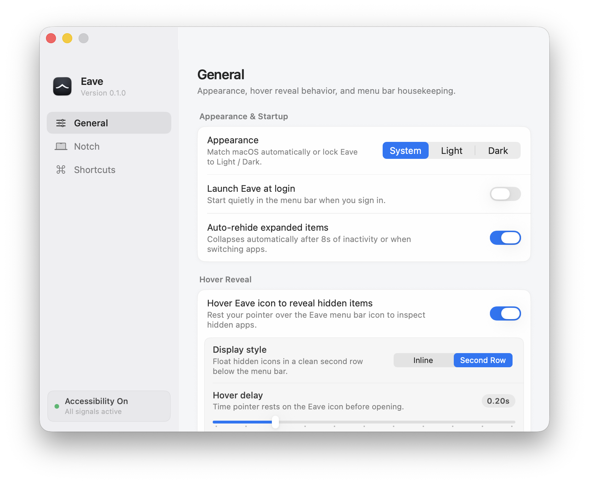

# Eave

A restrained, native macOS menu bar manager with textless Notch signals — built with pure Swift (`AppKit` + `SwiftUI`), zero third-party dependencies, and zero Screen Recording permission.

- **Minimum macOS**: macOS 15.0 (Sequoia), tuned for macOS 26 (Tahoe) with Liquid Glass support.
- **Architecture & Design**: See [docs/DESIGN.md](docs/DESIGN.md).

<p align="center">
  
</p>

<p align="center">
  
</p>

## Features

- **Two-Section Menu Bar Hiding**: Organize menu bar items into *Visible* and *Hidden* sections (`⌘`-drag icons left of the dot divider). Click the Eave icon or press `⌃⌥⌘H` to expand inline, with unified auto-rehide on inactivity or app switch. Keep the divider left of the Eave icon.
- **Floating Second-Row Bar**: Hover over the Eave icon on any display to reveal hidden items in a clean floating second row (horizontal scroll or multi-row wrap) without expanding the top menu bar.
  - **Smart Click Routing**: Left-clicking regular windowed apps brings them directly to the front with zero menu bar flicker; menu-bar-only utilities (such as Tailscale or Clash) support both left-click and right-click forwarding.
- **Textless Notch Signals & Watched Apps**: Single-line hardware-height wings flanking the MacBook notch — no intrusive text cards. Displays the app or sender icon on the left wing and a custom-colored accent dot, subtle 3-bar activity wave, or Fredoka-styled numeric badge on the right, with one-click deep-link or app activation.
  - **Auto-Watch Hidden Apps + Pinned Watchlist**: Automatically monitors hidden menu bar apps for new Dock unread badges (briefly peeking for a few seconds and retracting cleanly), and lets you **manually pin any app** (even apps kept visible in the menu bar, such as Slack, Mail, or WeCom) to receive Notch Peek alerts whenever new messages arrive.
- **Quick Menu Bar Search**: Press `⌥⌘K` to fuzzy-search and trigger any visible or hidden menu bar item from the keyboard.
- **NotchBridge (Local Automation API)**: Push lightweight visual signals to the notch from shell scripts, AI agent hooks, CLIs, or your own apps via `eave://notify?...` or `DistributedNotificationCenter`.
- **Appearance & Menu Bar Density**: Live System / Light / Dark appearance sync across Settings and floating panels, plus optional `NSStatusItemSpacing` tuning.

<p align="center">
  
</p>

## NotchBridge

Notch signals are intentionally textless and quiet — meant to be used sparingly for high-signal events like long builds, background AI agents, or custom app notifications.

### 1. Background Task → Done (Smooth State Transition)

```bash
# 1) Active background job (3-bar wave, blue accent, auto-expires after 60s if not cleared)
open -g "eave://notify?id=build&mode=ambient&style=wave&symbol=sparkles&accent=%2338BDF8&duration=60"

# 2) Finished — replaces the same id with a green rim shimmer + sonar ping (loops while visible)
#    Clicking the notch opens the callback URL or app
open -g "eave://notify?id=build&symbol=checkmark.circle.fill&accent=%2334C759&duration=8&loop=true&url=https://github.com"
```

### 2. Custom Local Icon + Optional Numeric Badge + Deep Link

```bash
# Use any local PNG/ICNS icon, custom accent color, optional numeric count, and click callback
open -g "eave://notify?id=inbox&icon=/path/to/icon.png&badge=3&accent=%23FF453A&url=myapp://inbox"

# Clear an ambient signal explicitly
open -g "eave://clear?id=inbox"
```

### 3. CLI Helper (`scripts/eave-notify`)

```bash
./scripts/eave-notify --id agent --mode ambient --style wave --symbol sparkles --accent "#38BDF8" --duration 60
./scripts/eave-notify --id agent --symbol checkmark.circle.fill --accent "#34C759" --duration 8 --loop --bundle-id com.mitchellh.ghostty
```

**Supported parameters**:

| Parameter | Description |
| :--- | :--- |
| `id` | Deduplication key; sending a `peek` with the same `id` clears its matching `ambient` signal. |
| `mode` | `peek` (transient, default), `ambient` (persistent until cleared or `duration` expires), or `clear`. |
| `icon` | Local image file path (`.png`, `.icns`, etc.) — highest icon priority. |
| `symbol` | Any macOS SF Symbol name (used when `icon` is omitted). |
| `bundleID` | App bundle ID (icon fallback + click-to-activate fallback). |
| `accent` | Hex highlight color (`#RRGGBB`, URL-encoded as `%23RRGGBB`) for the dot, wave, rim sweep, or badge. |
| `badge` | Optional strictly numeric count (e.g. `3`, `99+`). Omit for a clean dot-only signal. |
| `style` | `dot` (default quiet dot / sonar ping) or `wave` (minimal 3-bar breathing activity indicator). |
| `loop` | `true` / `false` (default `false`). When `true`, gently repeats the rim shimmer and sonar ping every ~2.2s while visible. |
| `url` | Callback URL / deep link opened when clicking the notch wings. |
| `duration` | Visibility duration in seconds (`1`–`300`). Defaults to user Peek duration for `peek`, or persistent until `clear` for `ambient`. |

## Install

Requires macOS 15 or newer.

```bash
brew tap abcdlsj/tap
brew trust abcdlsj/tap  # Homebrew refuses to load casks from an untrusted third-party tap
brew install --cask eave
```

Or download the dmg from [Releases](https://github.com/abcdlsj/eave/releases). Release builds are
ad-hoc signed and not notarised: a browser download is blocked by Gatekeeper on first launch
(right-click → Open), while a Homebrew install carries no quarantine attribute and just runs.

Basic two-section menu bar hiding requires **zero permissions**. Grant **Accessibility** in System
Settings → Privacy & Security → Accessibility to unlock hidden-app discovery, Dock badge alerts,
and menu-bar click forwarding. Eave never requests Screen Recording permission.

## Build & Run

Requires Xcode 26 (the build uses the macOS 26 SDK for Liquid Glass; the app itself
still deploys to macOS 15) and `xcodegen`.

```bash
# Generate icons and Xcode project
swift scripts/generate-icons.swift
xcodegen generate

# Build and test
xcodebuild -project Eave.xcodeproj -scheme Eave -configuration Debug build
xcodebuild -project Eave.xcodeproj -scheme Eave -configuration Debug test
```

## Release

Tagging `vX.Y.Z` runs [`.github/workflows/release.yml`](.github/workflows/release.yml): it builds
the universal dmg, publishes the GitHub release, and attaches an `eave.rb` cask generated from the
real dmg checksum. Copy that file into `abcdlsj/homebrew-tap`'s `Casks/`.

Bump `MARKETING_VERSION` in [project.yml](project.yml) before tagging; the workflow fails when the
tag and that version disagree. The same packaging runs locally:

```bash
scripts/package-release.sh 0.2.0                        # dmg + zip in dist/
scripts/write-cask.sh 0.2.0 dist/eave_0.2.0_darwin_universal.dmg  # dist/eave.rb
```

Set `EAVE_SIGN_IDENTITY` to sign with a Developer ID instead of ad-hoc.
